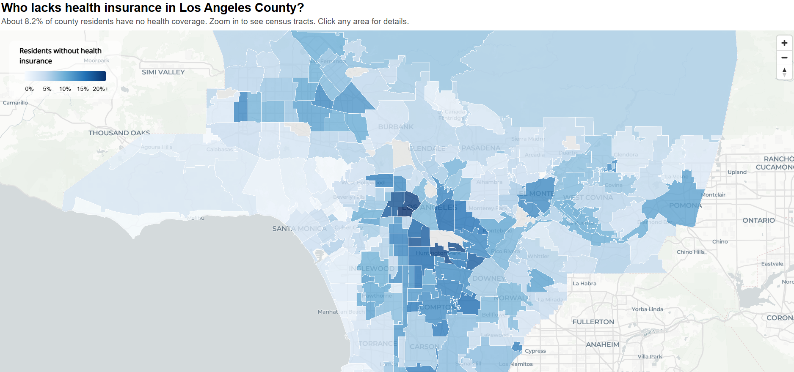

# Mapping Health Insurance in Los Angeles County in R: Neighborhoods and Census Tracts

This R project maps the share of residents without health insurance across Los Angeles County. I downloaded Census estimates for every census tract, grouped the tracts into named neighborhoods, and built an interactive map that shows neighborhoods when zoomed out and individual tracts when zoomed in.

[View the interactive map](https://shaneghim.github.io/lacountyuninsuredmap/)

**Data**

I used the U.S. Census Bureau's [American Community Survey (ACS)](https://www.census.gov/programs-surveys/acs) 2020-2024 5-year estimates, table S2701 (Selected Characteristics of Health Insurance Coverage), downloaded with the [tidycensus](https://walker-data.com/tidycensus/) R package. For each of LA County's roughly 2,500 census tracts, I pulled the percent uninsured, the number uninsured, and the population the rate is based on, along with each tract's boundaries.

For neighborhoods, I used the Los Angeles Times' [Mapping L.A.](https://github.com/datadesk/mapping-la-data) boundaries (MIT license), which divide the county into named neighborhoods, cities, and unincorporated areas. The base map is from CARTO, using © OpenStreetMap contributors data.

**Method**

<ins>Census tracts</ins>

A census tract is a small area the Census Bureau draws to report statistics, usually with 1,200 to 8,000 residents. Rates cover the civilian non-institutionalized population, the Census Bureau's standard base for health insurance, which excludes active-duty military and people living in institutions such as prisons, nursing homes, and psychiatric hospitals. I blanked out tracts with fewer than 100 residents (mainly airports, parks, and other nonresidential land), since their percentages aren't reliable.

<ins>Neighborhoods</ins>

Tracts don't line up exactly with neighborhood boundaries, so I assigned each tract to the neighborhood containing a point inside it. I did this on a flat map projection (EPSG 2229), which is more accurate for this kind of matching than longitude and latitude.

Because percentages can't be averaged across tracts of different sizes, I added up the number of uninsured residents and the total residents for each neighborhood, then divided. Neighborhoods with fewer than 1,000 residents were left out of the rankings. Of the LA Times' 318 areas, 261 had at least one LA County tract assigned to them.

<ins>Map</ins>

I built the map with the [mapgl](https://walker-data.com/mapgl/) package, which creates MapLibre GL JS maps from R. The color scale runs from 0% to 20%, with anything higher shown in the darkest color. Half of all tracts fall between about 4% and 12%, so a longer scale would make most of them look the same. Hovering shows each area's rate, and clicking shows about how many people are uninsured, how the area compares with the county rate, and its rank. For tracts, it also shows the margin of error.

**Results**

About 8.2% of LA County's civilian non-institutionalized population had no health insurance, or roughly 800,000 people. Across tracts, the median rate was 7.0%, and the middle half of tracts fell between 3.8% and 11.8%. The highest tract was 39.0%.

| Rank | Neighborhood    | Uninsured | Residents |  Rate |
|-----:|-----------------|----------:|----------:|------:|
|    1 | Pico-Union      |     8,487 |    36,290 | 23.4% |
|    2 | Westlake        |    19,926 |   106,968 | 18.6% |
|    3 | Huntington Park |     9,505 |    53,018 | 17.9% |
|    4 | Maywood         |     4,321 |    24,195 | 17.9% |
|    5 | Koreatown       |    17,618 |   101,386 | 17.4% |

\*Highest uninsured rates among neighborhoods with at least 1,000 residents.

**Findings**

The highest uninsured rates are concentrated in two clusters. Pico-Union, Westlake, and Koreatown sit next to each other just west of downtown Los Angeles, and Huntington Park and Maywood are neighboring cities in southeast LA County. Pico-Union's rate of 23.4% is nearly three times the county rate, and all five neighborhoods are more than twice the county rate.

Together, these five neighborhoods are home to about 3% of the county's residents but about 7.5% of its uninsured, around 60,000 people. All five have large immigrant populations, so these are also the areas where California's 2024 Medi-Cal expansion would be expected to have the biggest effect, which the 2020-2024 estimates only partly capture.

**Files**

- `index.html`: the interactive map
- `la_uninsured_neighborhoods.csv`: neighborhood totals (uninsured residents, population, rate, and rank)
- `la_uninsured_map.R`: the R script that downloads the data and builds the map
- `README.md`: this page
- `map_screenshot.png`: screenshot of the map used in this report

<ins>To rerun it</ins>

1.  Install [R](https://cran.r-project.org/) and [RStudio](https://posit.co/download/rstudio-desktop/), then install the packages listed at the top of the script.
2.  Get a free [Census API key](https://api.census.gov/data/key_signup.html) and save it in R with `tidycensus::census_api_key("YOUR_KEY", install = TRUE)`, then restart R.
3.  Open `la_uninsured_map.R` and run it section by section. The map saves as `la_uninsured_map.html`; rename it to `index.html` to publish it.

**Limitations**

These are survey estimates, so small differences between areas may not be meaningful, especially between neighborhoods, where I didn't calculate margins of error. Surveys also tend to undercount immigrants and people with unstable housing, who may be more likely to be uninsured. The data pools 2020-2024, so it only partly reflects California's 2024 Medi-Cal expansion, and each tract is counted entirely in one neighborhood, even if it crosses a boundary.
